# Desain Aplikasi — NC Finance (LPK Nida Course)

Aplikasi manajemen keuangan & administrasi peserta untuk LPK Nida Course. Frontend Next.js (App Router) + Tailwind, backend Java HTTP server + MySQL. Dokumen ini menampilkan rancangan tiap halaman dengan tangkapan layar versi desktop (1440×900) dan mobile (390×844), beserta penjelasan fungsi, komponen, dan alur.

---

## Identitas Visual

- **Warna utama:** `#111111` (teks/CTA), `#787774` (sekunder), `#eaeaea` (border), `#f9f9f8` (background lembut)
- **Aksen status:** hijau `#346538` (approved), kuning `#956400` (pending), merah `#9f2f2d` (rejected)
- **Tipografi:** sans-serif untuk UI, serif untuk heading judul halaman
- **Sudut:** rounded `8–16px`, kartu pakai border tipis bukan shadow tebal
- **Bahasa antarmuka:** Bahasa Indonesia

## Peran Pengguna

- **Staf** — input transaksi, daftarkan peserta, kelola berkas
- **Manajer** — semua akses staf + validasi transaksi, kelola user/kursus/profil lembaga

---

## 1. Halaman Login (`/login`)

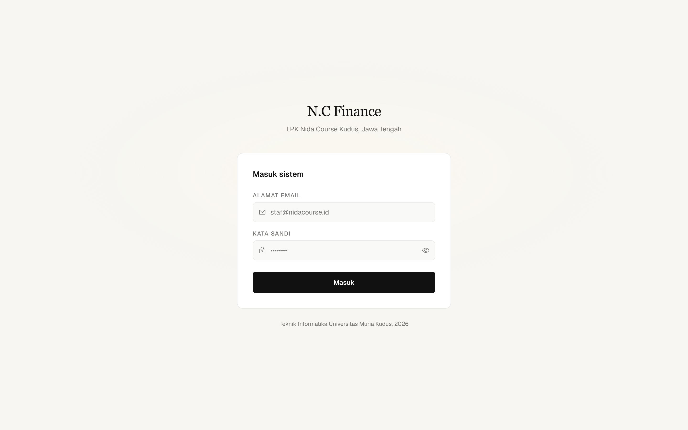

**Tujuan.** Pintu masuk aplikasi sebelum mengakses fitur lain. Semua halaman terkunci sampai user berhasil login.

**Komponen.**
- Form email + password (dua kolom, label di atas, autocomplete aktif).
- Tombol *Masuk* full width.
- Branding "NC Finance" di header.

**Alur.**
1. User isi email + password.
2. Submit → request `POST /api/auth/login` ke backend Java.
3. Token disimpan di `localStorage` (`nc_token`) + data user (`nc_user`).
4. Redirect ke `/dashboard`.

**Tampilan mobile.**

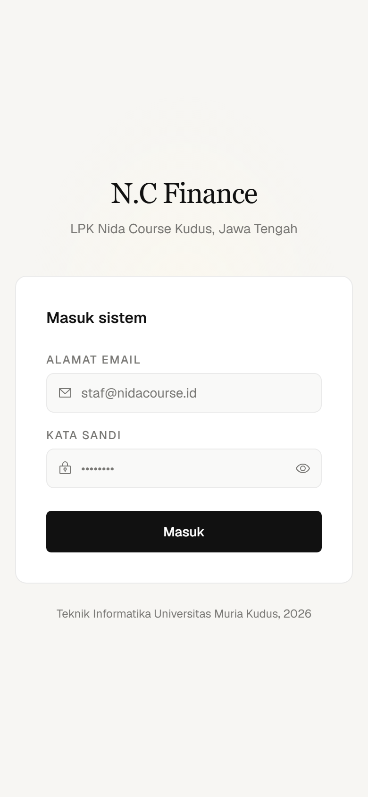

---

## 2. Dashboard (`/dashboard`)

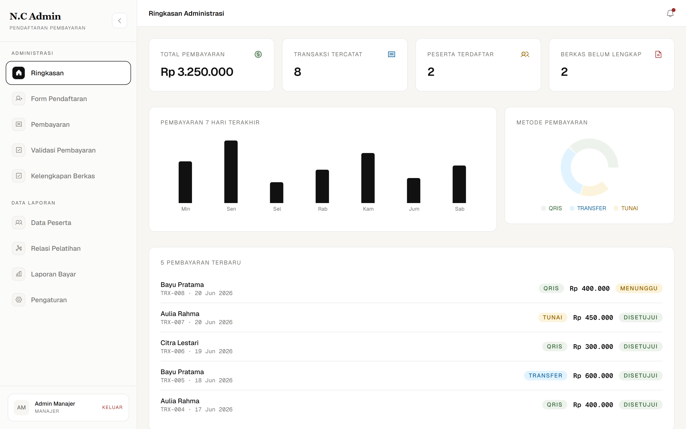

**Tujuan.** Ringkasan kondisi keuangan & operasional dalam satu layar.

**Komponen.**
- 4 kartu KPI: total pemasukan, jumlah peserta aktif, transaksi bulan ini, transaksi menunggu validasi.
- Bar chart **Pembayaran 7 Hari Terakhir** (data approved only).
- Pie chart distribusi **Metode Pembayaran** (QRIS / Transfer / Tunai).
- List **Transaksi Terbaru** (5 teratas, status badge berwarna).

**Logika data.**
- Sumber `GET /api/transaksi`, hanya transaksi `statusValidasi = approved` yang dihitung pada total/chart.
- Tanggal dikelompokkan per hari (timezone Asia/Jakarta).

**Tampilan mobile.**

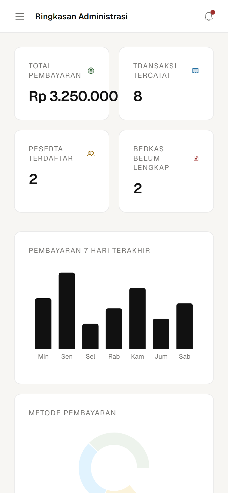

---

## 3. Pendaftaran Peserta (`/pendaftaran`)

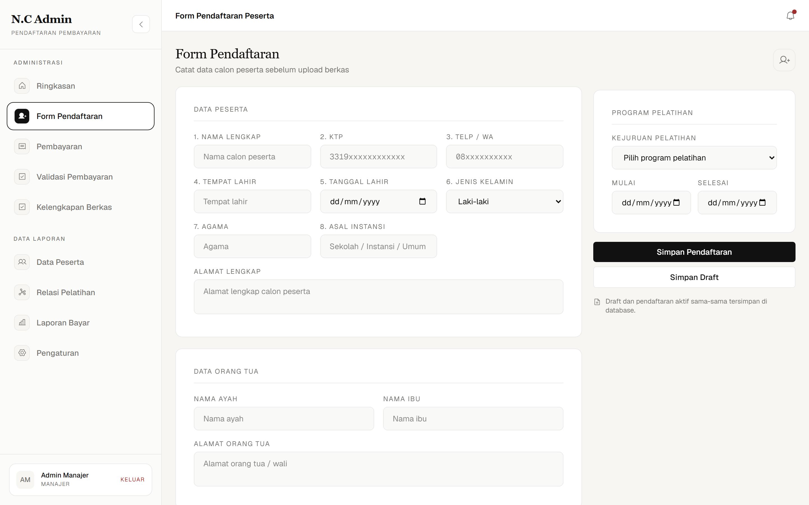

**Tujuan.** Mencatat data calon peserta sebelum pembayaran.

**Komponen.**
- Section **Data Peserta** (nama, KTP, telp, lahir, jenis kelamin, agama, asal instansi, alamat).
- Section **Data Orang Tua** (ayah, ibu, alamat).
- Section **Tanda Tangan** (tempat, tanggal, nama terang).
- Sidebar kanan **Program Pelatihan** (pilih kursus dari backend + tanggal mulai/selesai).
- Dua tombol submit: *Simpan Pendaftaran* (status `terdaftar`) dan *Simpan Draft* (status `draft`).

**Alur.**
1. User isi form.
2. Submit → `POST /api/pendaftaran` dengan field `statusPendaftaran`.
3. Backend simpan ke tabel `pendaftaran_peserta`.
4. Form reset + toast sukses.

**Tampilan mobile.**

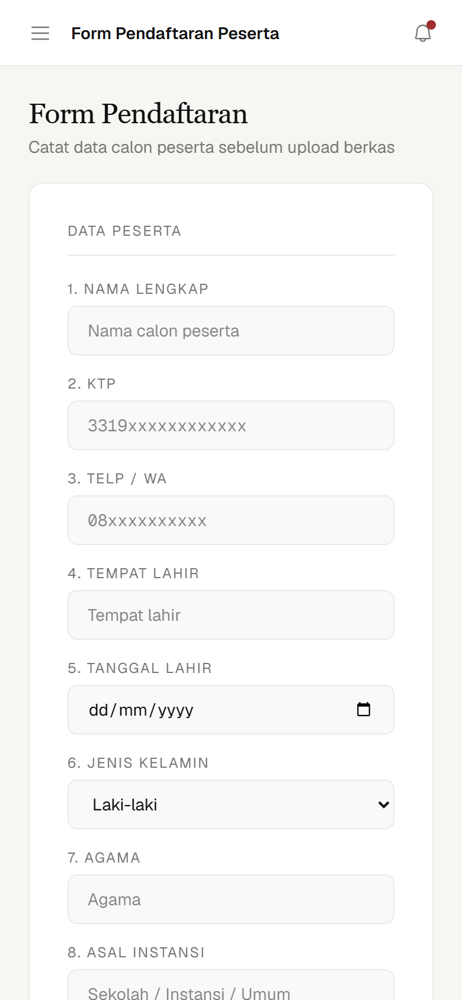

---

## 4. Data Siswa (`/siswa`)

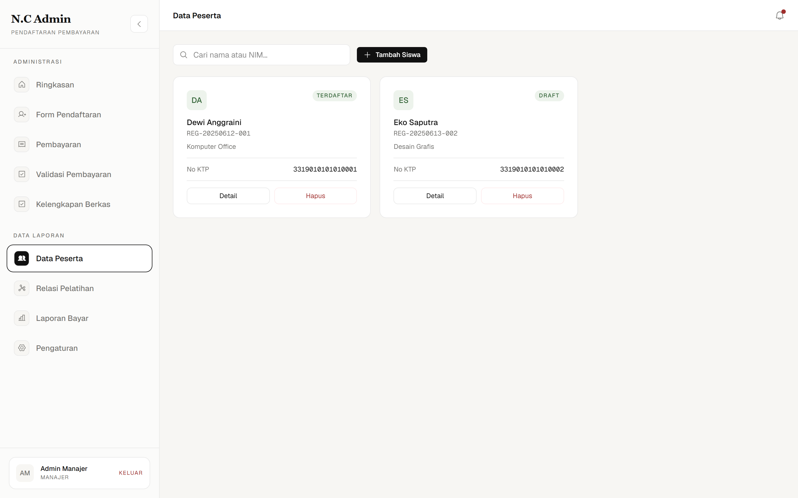

**Tujuan.** Mengelola data peserta aktif & pendaftar.

**Komponen.**
- Search bar (cari nama / NIM / nomor pendaftaran).
- Tombol *Tambah Siswa* → modal form (nama, NIM opsional auto-generate, kursus, no HP, alamat, tanggal pelatihan).
- Grid kartu peserta: avatar inisial, NIM, kursus, total biaya, status (aktif/selesai).
- Aksi per kartu: **Detail**, **Edit**, **Hapus** (hapus hanya untuk manajer).
- Modal detail siswa menampilkan profil + **Riwayat Pembayaran** lengkap dengan badge metode & status.

**Alur tambah siswa.**
1. Klik *Tambah Siswa* → modal terbuka.
2. Pilih kursus dari dropdown (data live dari `/api/pengaturan/kursus`).
3. Submit → `POST /api/siswa`, backend buat NIM otomatis kalau kosong.
4. Reload data → kartu baru muncul.

**Tampilan mobile.**

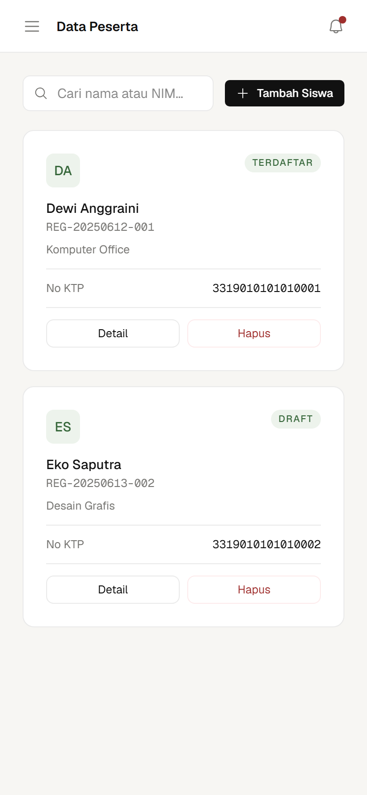

---

## 5. Graph Relasi Siswa–Kursus (`/siswa/graph`)

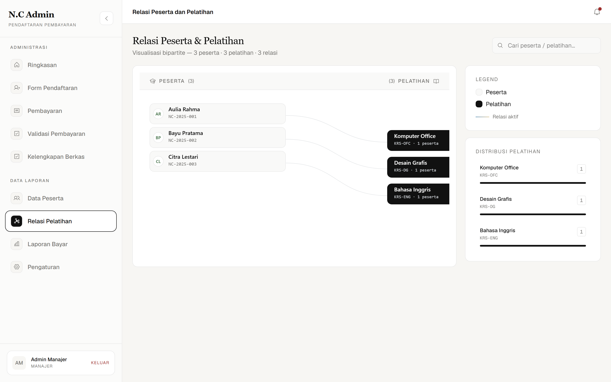

**Tujuan.** Visualisasi hubungan peserta dengan kursus yang diikuti (struktur data graf).

**Komponen.**
- Canvas force-directed graph.
- Node bulat = siswa, node persegi = kursus, edge menghubungkan keduanya.
- Legend warna + jumlah node/edge.

**Sumber data.** `GET /api/graph/siswa-kursus` (nodes + edges).

**Tampilan mobile.**

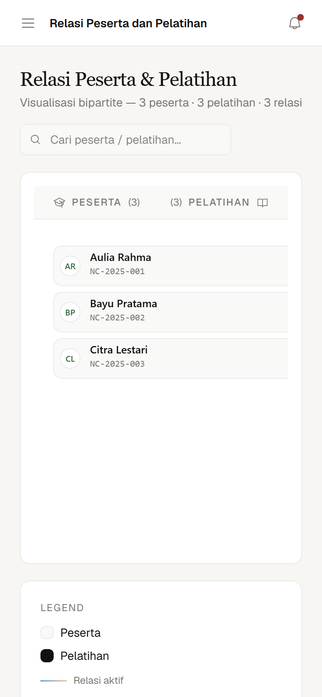

---

## 6. Transaksi (`/transaksi`)

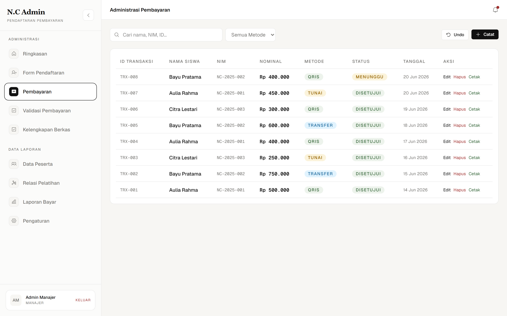

**Tujuan.** Daftar seluruh transaksi pembayaran dengan operasi CRUD + undo/restore.

**Komponen.**
- Tabel transaksi: ID, peserta, nominal, metode, status validasi, aksi.
- Filter status + search.
- Tombol *Undo* (kembalikan transaksi terakhir yang dihapus, pakai stack di backend).
- Modal *Edit Transaksi* (manajer-only untuk ubah status validasi).
- Modal *Hapus* dengan konfirmasi.

**Alur undo.**
1. Hapus transaksi → backend push ke undo stack.
2. Klik *Undo* → `DELETE /api/transaksi/undo` → backend pop & restore.
3. Toast konfirmasi.

**Tampilan mobile.**

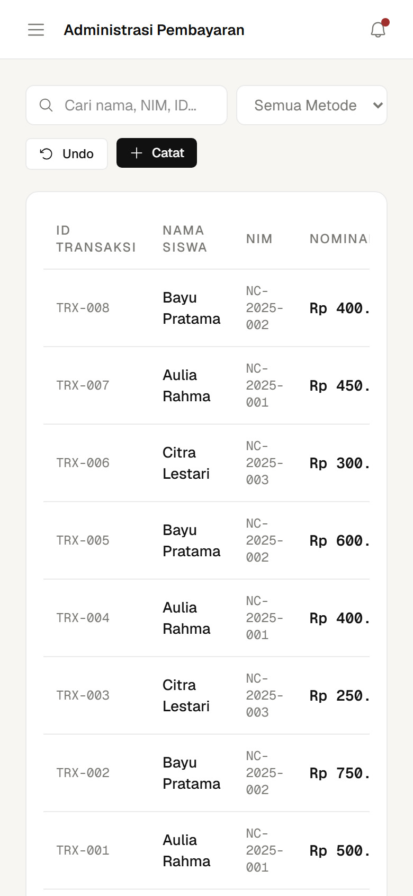

---

## 7. Input Transaksi (`/transaksi/input`)

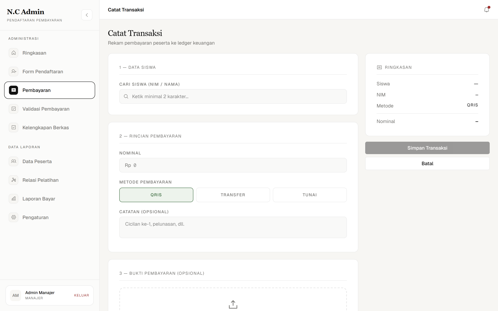

**Tujuan.** Mencatat pembayaran peserta dengan bukti & catatan.

**Komponen.**
- Pilih peserta (dropdown dari `/api/siswa`).
- Nominal (input rupiah dengan format ribuan otomatis).
- Metode pembayaran (QRIS / Transfer / Tunai).
- Upload bukti (data URL, simpan ke kolom `bukti_path LONGTEXT`).
- Catatan opsional.
- Tombol *Simpan*.

**Alur.**
1. Submit → `POST /api/transaksi` dengan `statusValidasi: pending`.
2. Masuk antrian validasi manajer.
3. Setelah disetujui, baru masuk perhitungan dashboard/laporan.

**Tampilan mobile.**

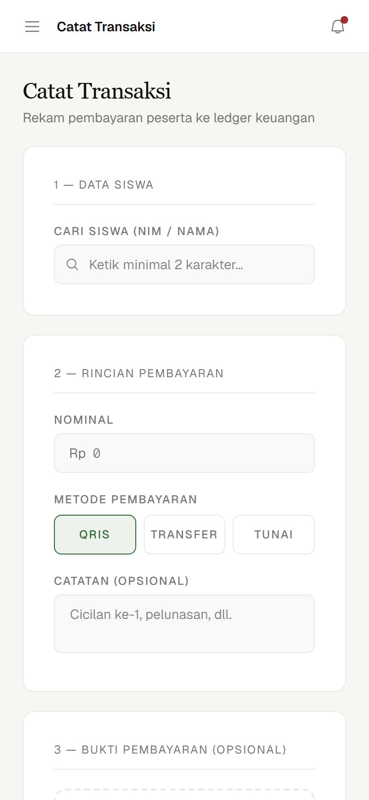

---

## 8. Validasi Transaksi (`/transaksi/validasi`)

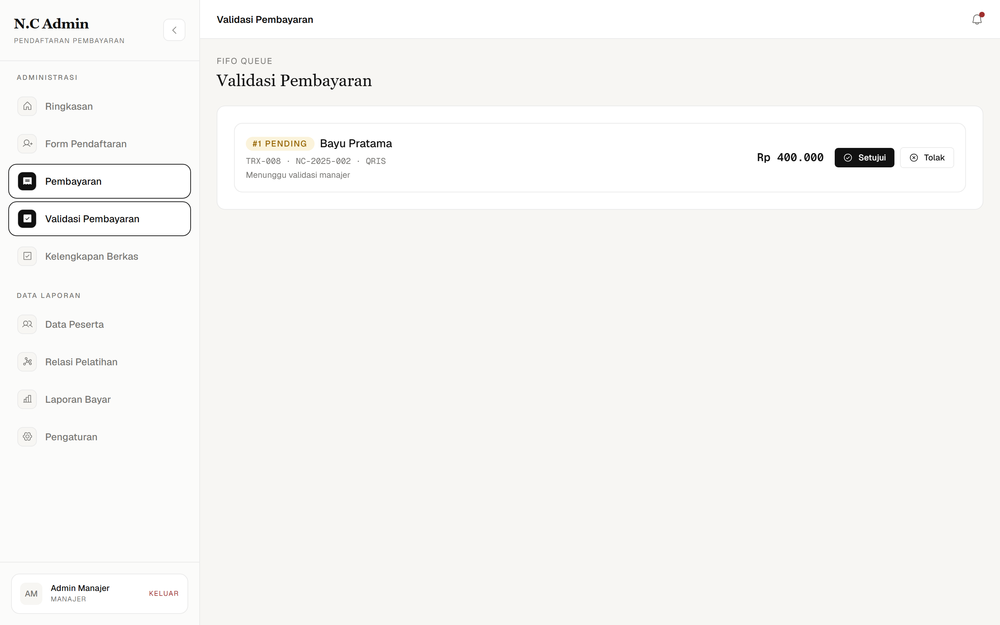

**Tujuan.** Antrian khusus manajer untuk approve/reject transaksi pending dari staf.

**Komponen.**
- Daftar kartu transaksi pending: peserta, nominal, metode, catatan, bukti.
- Tombol *Setujui* dan *Tolak* (dengan input alasan).
- Counter di topbar (notifikasi merah) menunjukkan jumlah pending.

**Alur approve/reject.**
1. Manajer review bukti.
2. Klik tombol → `PUT /api/transaksi/{id}/validate` dengan `status: approved|rejected`.
3. Kartu hilang dari antrian, status badge update di list transaksi.

**Akses.** Hanya role `manajer`. Staf yang mencoba dapat 403 dari backend.

**Tampilan mobile.**

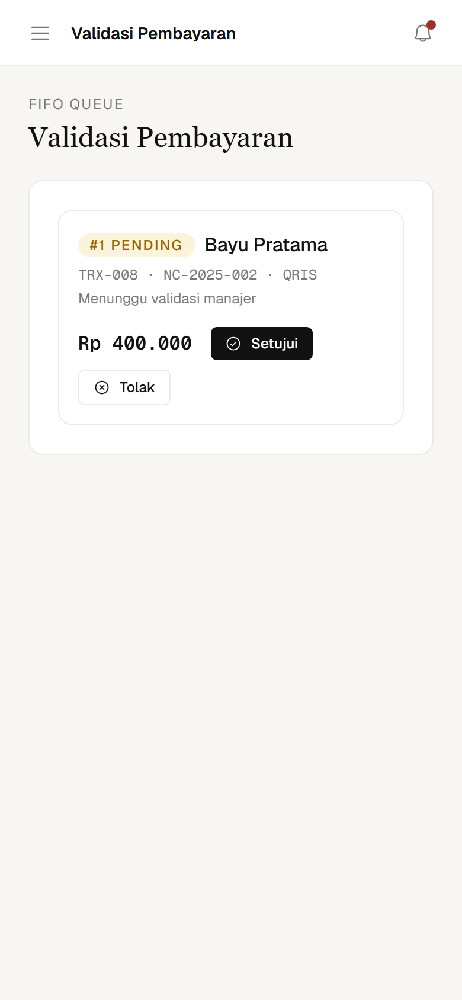

---

## 9. Berkas (`/berkas`)

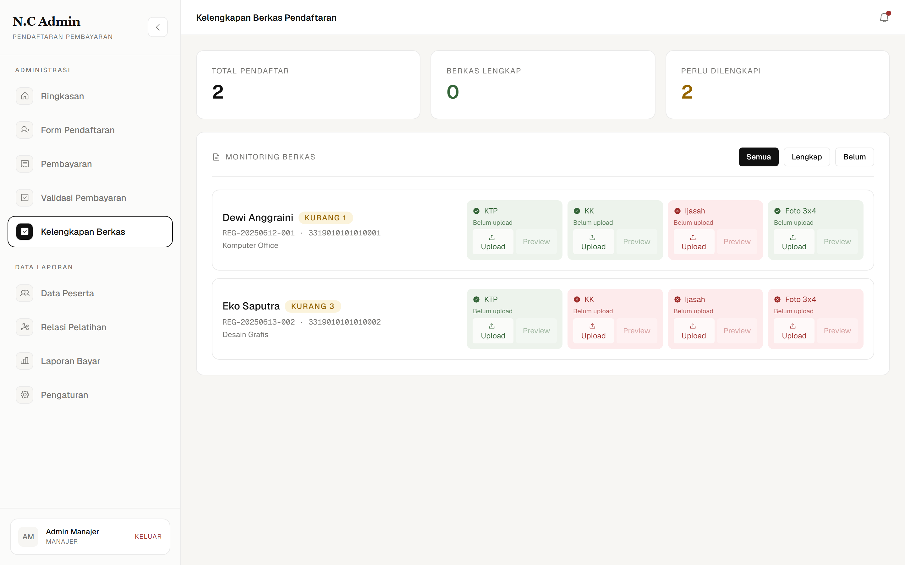

**Tujuan.** Memantau kelengkapan dokumen peserta (KTP, KK, ijazah, foto).

**Komponen.**
- Tabel peserta + 4 kolom checklist dokumen.
- Indikator persentase kelengkapan per peserta.
- Aksi upload/replace per dokumen.

**Sumber data.** `GET /api/pendaftaran`, update lewat `PUT /api/pendaftaran/{nomor}`.

**Tampilan mobile.**

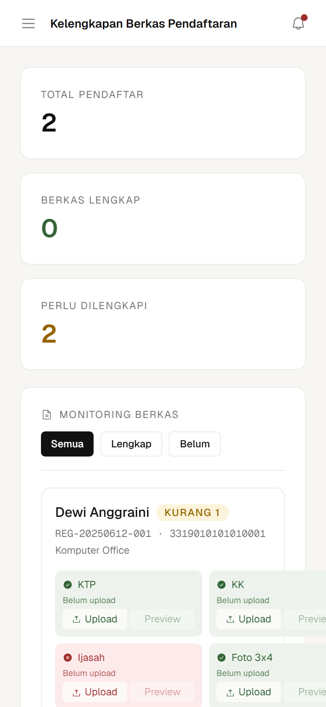

---

## 10. Laporan (`/laporan`)

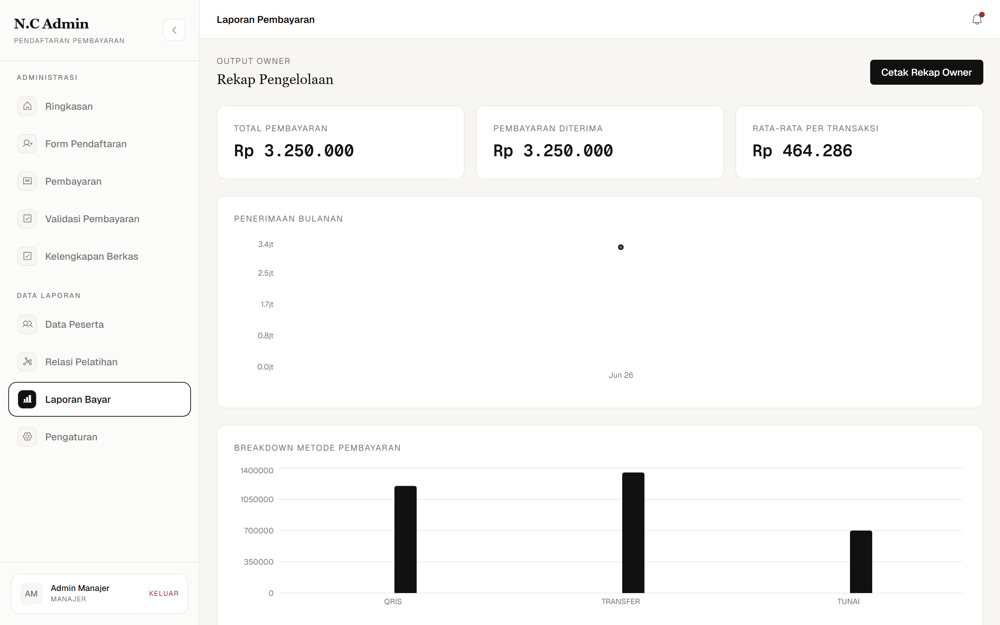

**Tujuan.** Rekap keuangan terstruktur untuk dilaporkan ke pengurus.

**Komponen.**
- Filter periode (bulan / rentang tanggal).
- Bar chart pemasukan harian.
- Pie chart distribusi metode pembayaran.
- Tabel detail transaksi (approved only).
- Tombol export (PDF/CSV — opsional).

**Aturan.** Semua angka dihitung dari transaksi `approved` saja. Pending & rejected dikecualikan.

**Tampilan mobile.**

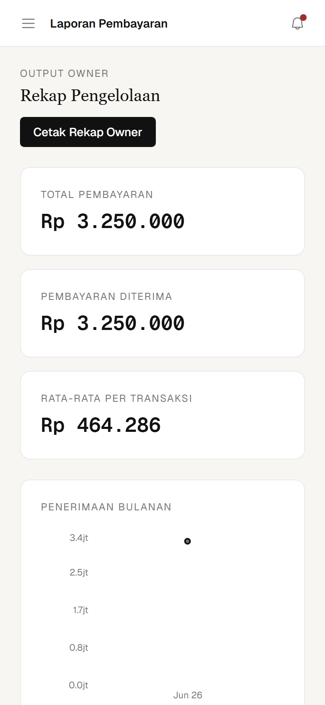

---

## 11. Pengaturan (`/pengaturan`)

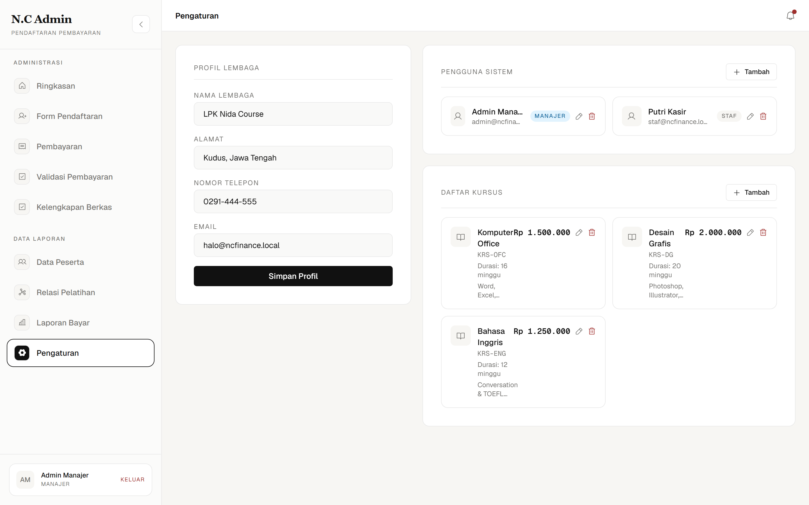

**Tujuan.** Master data sistem: profil lembaga, daftar pengguna, daftar kursus.

**Komponen.**
- **Profil Lembaga** — form nama, alamat, telepon, email lembaga (`PUT /api/pengaturan/profil`).
- **Pengguna Sistem** — list user dengan badge role, tombol edit/hapus, modal tambah user (nama, email, no HP, password, role staf/manajer).
- **Daftar Kursus** — list kursus dengan kode, nama, biaya (format rupiah), durasi minggu, deskripsi. Modal tambah/edit kursus.
- Semua perubahan validasi role manajer di backend.

**Tampilan mobile.**

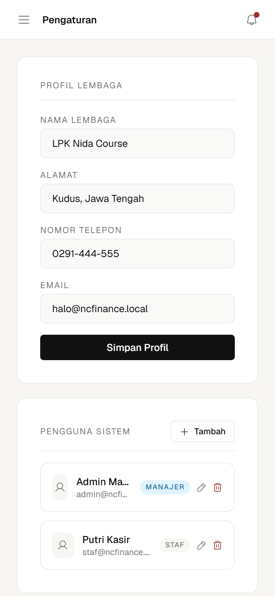

---

## Komponen Reusable

| Komponen | Lokasi | Fungsi |
|----------|--------|--------|
| `Sidebar` | `components/layout/Sidebar.tsx` | Navigasi utama, sembunyikan menu manajer untuk staf |
| `Topbar` | `components/layout/Topbar.tsx` | Notifikasi pending + user menu + logout |
| `Card` | `components/ui/Card.tsx` | Wrapper konten dengan border standar |
| `Button` | `components/ui/Button.tsx` | Varian primary/outline/ghost/danger |
| `Badge` | `components/ui/Badge.tsx` | `MetodeBadge`, `StatusBadge` |
| `FadeIn` | `components/ui/FadeIn.tsx` | Animasi entrance halus saat scroll |

## Flow Auth & Role

```
┌──────────┐  POST /api/auth/login   ┌──────────────┐
│  Login   │ ──────────────────────► │  Backend     │
└────┬─────┘  ◄────token+user─────── │  Java HTTP   │
     │ store nc_token, nc_user        │  + MySQL     │
     ▼                                └──────┬───────┘
┌────────────┐    GET /api/auth/me           │
│ App Layout │ ──────────────────────────────┘
│  (guard)   │ ─── invalid → redirect /login
└────┬───────┘
     ▼
┌──────────────────────────────────────────────┐
│ Halaman protected (role-aware sidebar)       │
│  - staf  : input, pendaftaran, berkas, dst.  │
│  - manajer: + validasi, pengaturan           │
└──────────────────────────────────────────────┘
```

## Catatan Implementasi

- Backend adalah satu-satunya sumber kebenaran (role check, status transaksi, undo stack).
- Frontend tidak boleh "memalsukan" data — semua list dari endpoint, modal CRUD selalu round-trip ke backend.
- Transaksi baru selalu `pending` sampai manajer menyetujui.
- Restore transaksi dilakukan via backend (`POST /api/transaksi/restore`), bukan state lokal.
- Skema database otomatis di-upgrade saat startup (`AppContext.ensureSchemaUpgrades()`) untuk kolom baru seperti `catatan` dan `profil_lembaga`.
